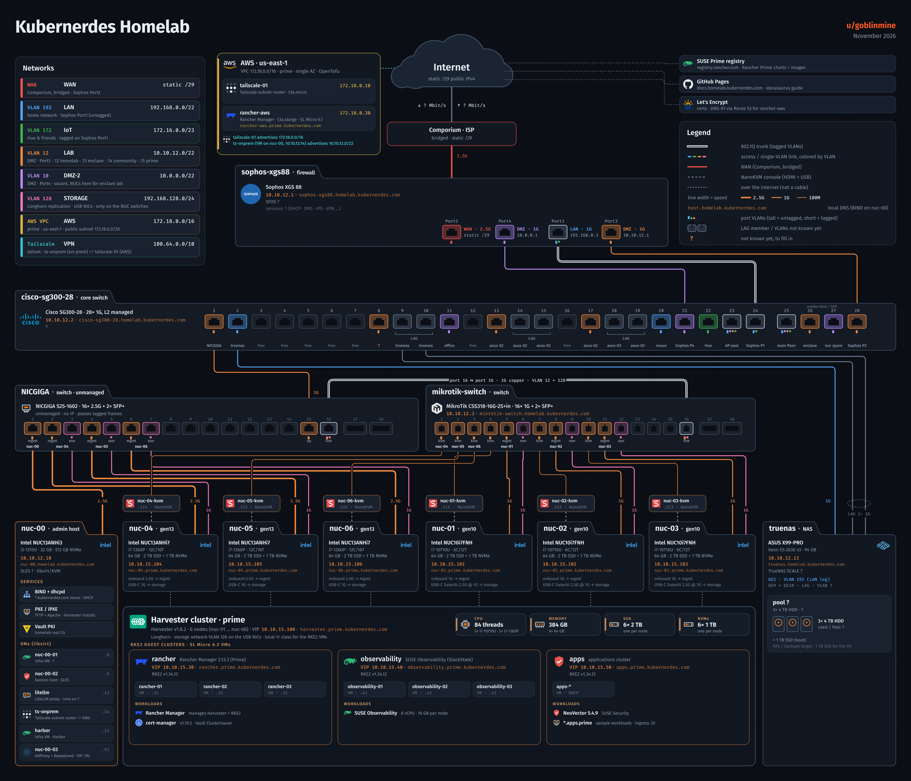

# Diagram

Network and hardware diagram of the homelab, rendered from `inventory.yaml`.



Based on [Goblinmine/homelab-diagram](https://github.com/Goblinmine/homelab-diagram) (MIT, see `LICENSE`), adapted to this lab. `inventory.yaml` holds the content. `build.py` holds the layout, with every box and cable placed by hand. Adding a node, switch or cluster usually means changing coordinates in `build.py` as well as the YAML.

## Render

Requirements: [uv](https://docs.astral.sh/uv/), `rsvg-convert` (librsvg) and the Fira Sans and Fira Code fonts.

```bash
brew install librsvg uv
brew install --cask font-fira-sans font-fira-code
./render.sh            # fetches the icons on the first run, writes Diagram/homelab.png
./render.sh --icons    # fetches the icons again (after adding one to fetch_icons.py)
```

The third-party icons are downloaded into `icons/` and are not committed. Only the `glyph-*.svg` files are committed.

## Keeping it in sync with the repo

`inventory.yaml` mirrors these files. Update it in the same commit when they change:

| Change in the lab | Source of truth | Section in `inventory.yaml` |
|---|---|---|
| Host IPs and names | `Files/nuc-00/var/lib/named/master/db.*` | `nuc00`, `nas`, `harvester.nodes`, `harvester.clusters` |
| KVM IPs | `Files/nuc-00/etc/dhcpd.d/dhcpd-kvms.conf` | `harvester.nodes[].kvm` |
| Versions (Harvester, RKE2, Rancher, NeuVector) | `Scripts/env.d/*.sh` | `harvester.version`, `clusters[].k8s`, `clusters[].apps` |
| Storage network | `Scripts/env.d/*.sh` (`STORAGE_NETWORK_*`) | `vlans` (VLAN 128), `harvester.storage_note` |
| Hardware | `Hardware.md` | `harvester.nodes`, `nuc00.model`, `nas.model` |
| AWS VPC, instances, Tailscale routers | `OpenTofu/aws/` (`variables.tf`, `tailscale.tf`), `Scripts/env.sh` (`AWS_VPC_CIDR`) | `aws`, `vlans` (AWS VPC, Tailscale) |
| Sophos zones, switch ports and cabling | `Network_Devices.md` (filled in from the Sophos/Cisco UIs and the switch LEDs) | `vlans`, `firewall.ports`, `core.ports` |

`?` in the YAML (and in the picture) marks something that is not known yet.

Do not put the Sophos WAN public IP in the inventory.
